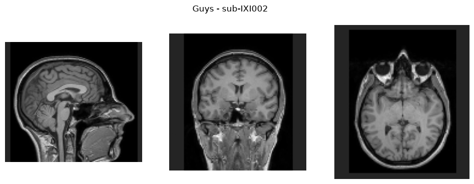
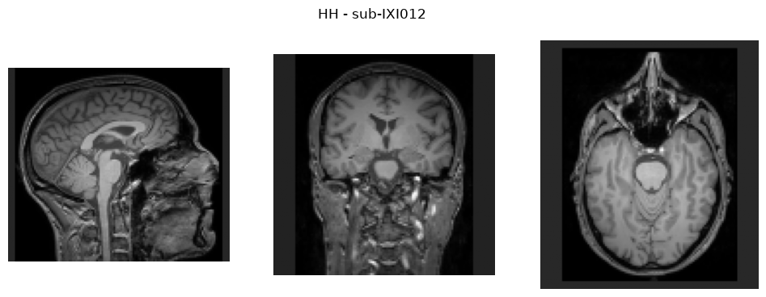
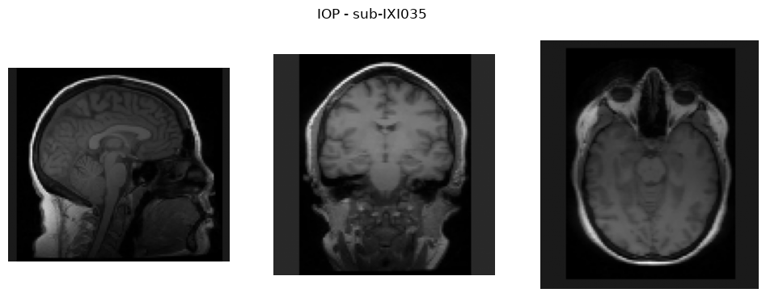

# ixi-brain-age

Brain age prediction from T1-weighted MRI of the [IXI](https://brain-development.org/ixi-dataset/) dataset, using [ClinicaDL 2.0](https://clinicadl.readthedocs.io/) and a 3D DenseNet (MONAI).

The goal is to measure, and then reduce, the effect of a **domain shift between hospitals** (site shift). IXI comes from 3 London hospitals (Guys, HH, IOP); each one is held out in turn:

- training on the two other hospitals (subject-level split: train / validation / internal test);
- evaluation on the internal test set (same hospitals, unseen subjects): **in-site**;
- evaluation on the held-out hospital, never seen during training: **out-of-site**.

## Preprocessing

Two preprocessings of the same images are compared:

- **Baseline**: resampling to 2 mm, z-normalization and crop, computed once by `scripts/cache_preprocessed.py` (`data/IXI/bids_2mm`). No registration.
- **Clinica t1-linear**: N4 bias field correction and affine registration to the MNI template, run locally by `scripts/t1_linear_wsl.sh` (~8 h on CPU for 563 images), then resampled to 2 mm by `scripts/t1linear_to_2mm.py` (`data/IXI/caps_t1linear_2mm`). Selected with `--data t1linear`.

One image per hospital after the baseline preprocessing (output of `--check`):

| Guys | HH | IOP |
|:---:|:---:|:---:|
|  |  |  |

## Structure

```
scripts/ixi_to_bids.py                IXI -> BIDS conversion + age table
scripts/cache_preprocessed.py         one-off baseline preprocessing (2 mm, normalization, crop)
scripts/t1_linear_wsl.sh              Clinica t1-linear on all subjects (Linux / WSL, resumable batches)
scripts/t1linear_to_2mm.py            2 mm copy of the t1-linear images
scripts/train_ixi_site_shift.py       training and in-site / out-of-site evaluation
scripts/predict_ages.py               signed predictions (predicted - true age) and plots
notebooks/ixi_brain_age_colab.ipynb   end-to-end run on Google Colab
docs/                                 preprocessing check images, experiment journal
```

## Reproduce

The IXI data is **not included** in this repository. Download it from the official source: https://brain-development.org/ixi-dataset/ (see the terms of use on that site).

1. Install the dependencies:
   ```bash
   pip install -r requirements.txt
   ```
2. Download `IXI-T1.tar` and `IXI.xls`, and place them as follows:
   ```
   data/IXI/raw/IXI002-Guys-0828-T1.nii.gz ...   (extracted from IXI-T1.tar)
   data/IXI/IXI.xls
   ```
3. Convert to BIDS (output in `data/IXI/bids/`):
   ```bash
   python scripts/ixi_to_bids.py
   ```
4. Precompute the preprocessing (output in `data/IXI/bids_2mm/`):
   ```bash
   python scripts/cache_preprocessed.py
   ```
5. Check the preprocessing on one image per hospital:
   ```bash
   python scripts/train_ixi_site_shift.py --check
   ```
6. Train and evaluate (options: `--epochs`, `--batch-size`, `--lr`):
   ```bash
   python scripts/train_ixi_site_shift.py --test-site IOP
   ```
7. Compute signed predictions and plots:
   ```bash
   python scripts/predict_ages.py --test-site IOP
   ```

Results are written to `outputs/site_shift_test-IOP/`.

For the t1-linear images: run Clinica t1-linear with `bash scripts/t1_linear_wsl.sh` (Linux / WSL, Clinica installed in `~/clinica_env`), then add `--data t1linear` to steps 5-7 (results in `outputs/site_shift_test-<site>_t1linear/`). Add `--augment` to steps 6-7 for the contrast augmentation (results in `..._t1linear_aug/`).

## Results

Each hospital is held out in turn. Out-of-site mean absolute error (MAE) in years, i.e. on the hospital never seen in training (in-site MAE in parentheses; AdaBN does not change in-site predictions):

| Held-out hospital | v1: baseline | v2: t1-linear | v3a: + contrast augmentation | v3b: v3a + AdaBN |
|---|---|---|---|---|
| IOP | 10.8 (5.8) | 11.2 (6.8) | **8.8** (5.7) | 10.2 |
| HH | 25.2 (7.9) | 8.6 (7.1) | 9.3 (7.9) | **7.6** |
| Guys | 17.1 (7.5) | 8.9 (7.0) | 10.9 (7.0) | **8.4** |

For reference, always predicting the mean training age gives an MAE of about 14-16 years.

- **v1, baseline**: the error is 2 to 3 times higher on an unseen hospital, and systematic: HH subjects are all predicted too young, Guys subjects too old, older IOP subjects too young. Subjects are still ranked correctly by age (correlation ≈ 0.7-0.8): the model has partly learned each scanner's image style.
- **v2, Clinica t1-linear** (bias field correction + registration) **removes most of the HH and Guys shift**: their out-of-site error becomes close to the in-site error. IOP is not fixed: it has a very different tissue contrast, which registration does not change.
- **v3a, contrast augmentation** (random gamma and bias field during training) **fixes much of the IOP shift** (correlation 0.52 → 0.82), and does not help HH and Guys, whose remaining error is mostly an offset that varies from run to run.
- **v3b, AdaBN** (BatchNorm statistics re-estimated on the unseen hospital's images, without their ages, no retraining) **removes that offset for HH and Guys**, but makes IOP worse: IOP subjects are 7 years younger on average than the training hospitals, and AdaBN cannot tell this population difference from a scanner difference (label shift). The size and sign of the AdaBN bias follow the age gap at all three hospitals.

Next steps: stabilize training (noisy validation curves, several seeds), then DANN, with the label-shift caveat in mind. Single run per configuration; details, plots and analyses in [docs/journal.md](docs/journal.md).
