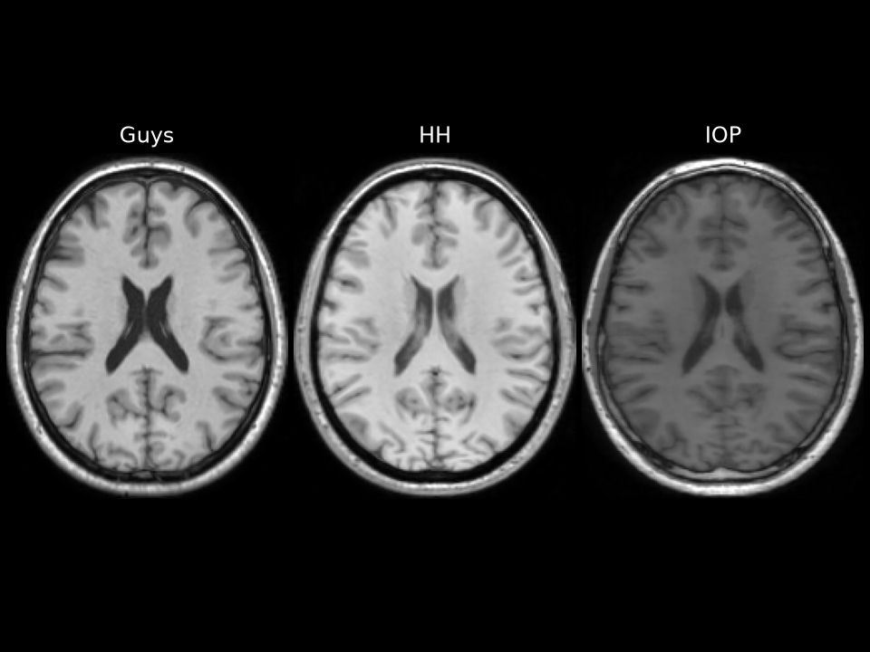
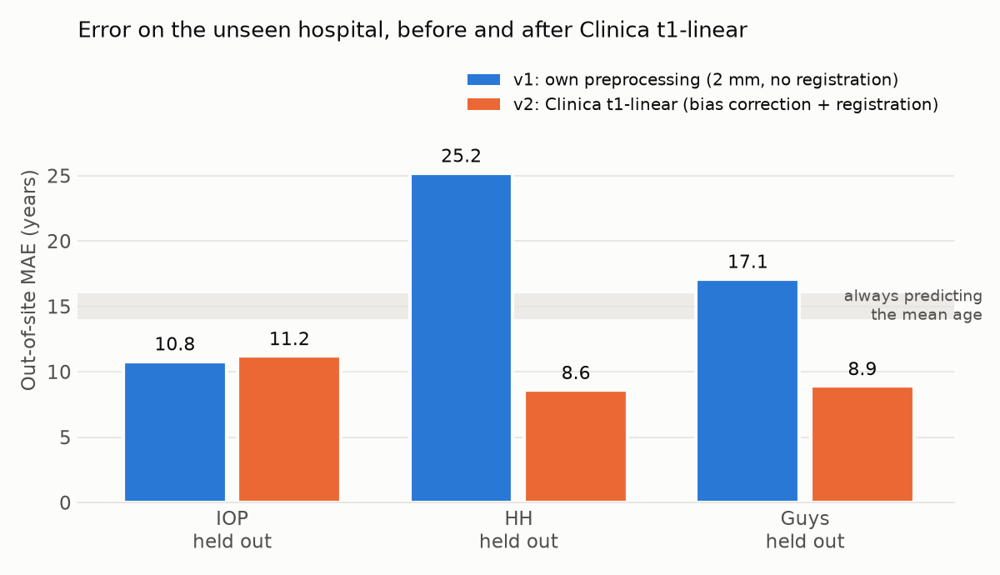
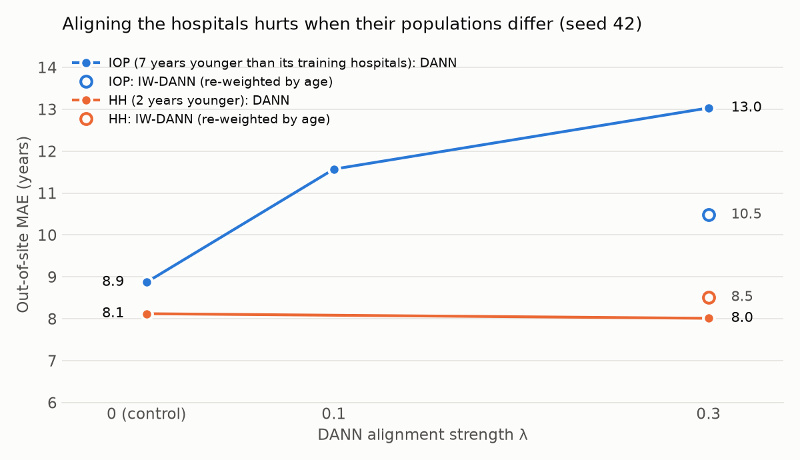

# ixi-brain-age

**When does a brain age model break on a new hospital, and what fixes it?**

A 3D DenseNet predicts age from T1-weighted MRI of the [IXI](https://brain-development.org/ixi-dataset/) dataset (563 subjects, 3 London hospitals), built with [Clinica](https://aramislab.paris.inria.fr/clinica/docs/public/latest/) and [ClinicaDL 2.0](https://clinicadl.readthedocs.io/). Each hospital is held out in turn: the model is trained on the two others and tested on the unseen one.


*One 45-year-old subject per hospital, after Clinica t1-linear. IOP images are darker, with less contrast between tissues.*

## Key findings

1. **Preprocessing removes the geometric part of the shift.** With a simple preprocessing, the error on an unseen hospital is 2 to 3 times the error on the training hospitals. Clinica t1-linear (bias field correction + affine registration) brings HH from 25.2 to 8.6 years and Guys from 17.1 to 8.9, close to their in-site error.
2. **Contrast differences need augmentation.** The third hospital (IOP) keeps a different tissue contrast after registration; random contrast augmentation during training improves how well its subjects are ranked by age (correlation 0.52 → 0.66-0.82).
3. **Domain adaptation fails under label shift.** IOP's subjects are also 7 years younger than the training hospitals'. Unsupervised alignment (AdaBN, DANN) cannot tell this population difference from a scanner difference: it pulls IOP's predictions towards the training population, and the stronger the alignment, the larger the error. On HH, whose population matches the training hospitals, the same methods are neutral or slightly helpful. Re-weighting the source by age (IW-DANN) halves the effect on IOP without removing it.

## Setup

- **Data**: IXI T1 MRIs with age, 563 subjects: Guys (314), HH (181), IOP (68). Mean ages 50.8 / 47.4 / 42.4 years.
- **Protocol**: one hospital held out; the two others are split by subject into train / validation / internal test. **In-site** = internal test set (unseen subjects, same hospitals), **out-of-site** = the held-out hospital. Metric: mean absolute error (MAE, years). Always predicting the mean age gives 14-16 years.
- **Model**: MONAI DenseNet121 (3D), age normalized inside the model, MSE loss, Adam (lr 1e-4), batch size 8, 2 mm images, Google Colab T4 GPU.
- **Stages**: v1 = own preprocessing (2 mm, z-normalization, crop); v2 = Clinica t1-linear; v3a = + contrast augmentation (random gamma and bias field); v3b = unsupervised domain adaptation (AdaBN, DANN, IW-DANN).

## Results



Out-of-site MAE in years (in-site MAE in parentheses; single runs, seed 42, unless stated):

| Held-out hospital | v1: own preprocessing | v2: t1-linear | v3a: + contrast augmentation | v3a + AdaBN |
|---|---|---|---|---|
| IOP | 10.8 (5.8) | 11.2 (6.8) | 8.8 (5.7); **10.9 ± 1.7 over 3 seeds** | 10.2 |
| HH | 25.2 (7.9) | 8.6 (7.1) | 9.3 (7.9) | **7.6** |
| Guys | 17.1 (7.5) | 8.9 (7.0) | 10.9 (7.0) | **8.4** |

- **v1**: the out-of-site error is large and systematic, in a direction that depends on the hospital (HH predicted too young, Guys too old), while subjects stay correctly ranked (correlation ≈ 0.7-0.8): the model has partly learned each scanner's image style.
- **Run-to-run variability**: on IOP, 3 seeds of the v3a configuration give 10.9 ± 1.7 years out-of-site (in-site 6.5 ± 0.8). Differences below ~2 years between single runs are not meaningful; the single v3a IOP run (8.8) was a favorable draw. The same experiment showed that the model at the end of training generalizes better than the best validation epoch (often an early, lucky dip of a noisy validation curve), so all later results use the final model.
- **AdaBN** (BatchNorm statistics re-estimated on the unseen hospital's images, no labels, no retraining) removes the remaining offset for HH and Guys but makes IOP worse. The sign and size of its bias follow the age gap between the unseen hospital and the training hospitals at all three sites.

**DANN** (domain-adversarial fine-tuning with a gradient reversal layer, starting from the v3a model; same setting on both hospitals):



| Seed 42 | IOP: out-of-site MAE | IOP: mean predicted age | HH: out-of-site MAE | HH: mean predicted age |
|---|---|---|---|---|
| true mean age (not used by the methods) | | 42.4 | | 47.4 |
| control: same fine-tuning, no domain loss | **8.9** | 38.2 | 8.1 | 46.7 |
| DANN λ = 0.1 | 11.6 | 49.3 | | |
| DANN λ = 0.3 | 13.0 | 52.2 | 8.0 | 44.3 |
| IW-DANN λ = 0.3 (source re-weighted by age) | 10.5 | 46.8 | 8.5 | 42.6 |

- Without alignment, a small classifier recognizes the hospital from the network's features with 96 % (IOP) and 88 % (HH) accuracy. DANN brings it to ≈ 50 % in every configuration, without degrading age prediction on the training hospitals.
- On IOP, making the domains indistinguishable also makes IOP's patients look as old as the training population: the mean predicted age rises from 38 to 52 years as λ increases. On HH, the same alignment moves it by 2 years.
- IW-DANN estimates the unseen hospital's age distribution from the model's predictions, which are compressed towards the mean (regression to the mean): on HH, its weights show that it under-weights young and old subjects and over-corrects; the same compression likely limits the correction on IOP.

Full numbers, per-age-group errors, training curves and the reasoning behind each choice: [docs/journal.md](docs/journal.md).

## Limitations

- One public dataset (563 subjects, 3 hospitals); one train / validation split; most configurations run with a single seed, while the seed-to-seed spread is about ±1.7 years out-of-site.
- Brain age error is ~6 years in-site, far from the 2.5-4 years of models trained on tens of thousands of subjects: the study is about the gaps between hospitals, not absolute performance.
- No skull stripping; 2 mm images; AdaBN and DANN use the unseen hospital's images (without ages) in a transductive setting.

## Repository structure

```
scripts/ixi_to_bids.py                IXI -> BIDS conversion + age table
scripts/cache_preprocessed.py         v1 preprocessing (2 mm, normalization, crop), computed once
scripts/t1_linear_wsl.sh              Clinica t1-linear on all subjects (Linux / WSL, resumable batches)
scripts/t1linear_to_2mm.py            2 mm copy of the t1-linear images
scripts/train_ixi_site_shift.py       training and in-site / out-of-site evaluation (ClinicaDL 2.0)
scripts/predict_ages.py               signed predictions (predicted - true age), per-age-group errors, plots
scripts/adabn.py                      AdaBN on a trained model
scripts/train_dann.py                 DANN / IW-DANN fine-tuning
scripts/make_figures.py               README figures
notebooks/ixi_brain_age_colab.ipynb   all experiments on Google Colab, step by step
notebooks/site_dann_pipeline.ipynb    one click: source model + AdaBN + DANN for one held-out hospital
docs/journal.md                       experiment journal: configurations, raw results, interpretation
```

## Reproduce

The IXI data is **not included** in this repository. Download it from the official source, https://brain-development.org/ixi-dataset/ (license CC BY-SA 3.0).

1. Install the dependencies: `pip install -r requirements.txt`
2. Place `IXI-T1.tar` (extracted into `data/IXI/raw/`) and `IXI.xls` (in `data/IXI/`), then convert to BIDS:
   ```bash
   python scripts/ixi_to_bids.py
   ```
3. Preprocessing:
   - v1: `python scripts/cache_preprocessed.py` (output `data/IXI/bids_2mm/`)
   - v2: `bash scripts/t1_linear_wsl.sh` (Linux / WSL, Clinica 0.12 installed in `~/clinica_env`; ~8 h on CPU; output `data/IXI/caps_t1linear_2mm/`)
4. Train and evaluate, e.g. t1-linear images, contrast augmentation, learning-rate scheduler, IOP held out:
   ```bash
   python scripts/train_ixi_site_shift.py --data t1linear --augment --scheduler plateau --test-site IOP --seed 42
   python scripts/predict_ages.py         --data t1linear --augment --scheduler plateau --test-site IOP --seed 42 --checkpoint final
   python scripts/adabn.py                --data t1linear --augment --scheduler plateau --test-site IOP --seed 42 --checkpoint final
   python scripts/train_dann.py           --data t1linear --augment --scheduler plateau --test-site IOP --seed 42 --lambda-max 0.3 --iw
   ```
   Without `--data t1linear`, the v1 images are used. Results go to `outputs/site_shift_test-<site>[_t1linear][_aug][_plateau][_seed<n>][_dann...]/`.

On Google Colab, `notebooks/site_dann_pipeline.ipynb` runs step 4 (source model, AdaBN, DANN) for one hospital in about 2.5 hours on a T4.

## Future work

- More seeds for every configuration, and the v2 configuration without augmentation, to measure the effect of augmentation precisely.
- A better estimate of the unseen hospital's age distribution for IW-DANN (correcting the compressed predictions, or black-box shift estimation).
- Ablation N4 bias correction vs registration; skull stripping; a second dataset.

## Acknowledgements

IXI dataset: https://brain-development.org/ixi-dataset/ (CC BY-SA 3.0). Preprocessing with Clinica and training with ClinicaDL, developed by the ARAMIS Lab (Paris Brain Institute / Inria).
